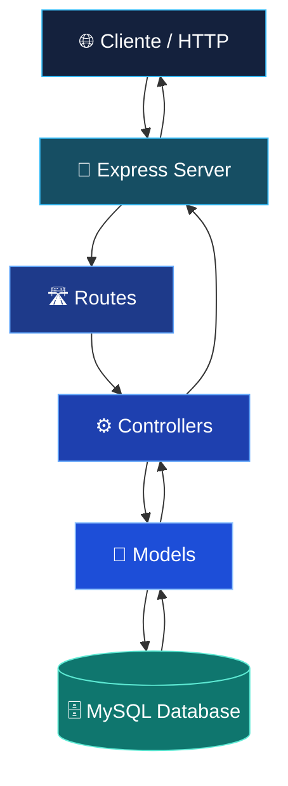

<div align="center">

# 🎬 UNIFECAF FLIX

### 🚀 REST API • NODE.JS • EXPRESS • MYSQL • THREE.JS

**Um catálogo cinematográfico full stack: API REST, banco MySQL e interface web com planeta 3D interativo.**


<br>


</div>

---

## 🌌 Sobre o projeto

O **UniFECAF Flix** é uma aplicação full stack para consultar um catálogo de filmes armazenado em um banco de dados MySQL.

O back-end é uma API REST em Node.js e Express. O front-end, em HTML, CSS e JavaScript puro, consome essa API e exibe os filmes em uma interface escura e cinematográfica, com um planeta 3D interativo feito em Three.js.

O projeto utiliza **Node.js**, **Express** e arquitetura **MVC**, com foco em organização, boas práticas de desenvolvimento Backend e integração com bancos de dados relacionais.

Desenvolvido como projeto acadêmico do curso de **Análise e Desenvolvimento de Sistemas — UniFECAF**.

### ✨ Funcionalidades

- 🎞️ Listagem de filmes cadastrados.
- 🔎 Pesquisa de filmes por nome ou sinopse.
- 🎯 Consulta individual por ID.
- 🗄️ Integração com MySQL.
- 🛡️ Validação de parâmetros.
- ⚡ Tratamento de erros HTTP.
- 🧩 Organização em arquitetura MVC.
- 🪐 Planeta 3D interativo (Three.js): gira sozinho e pode ser arrastado com o mouse, com inércia.
- 🎬 Cards com pôster, animações suaves e janela de detalhes acessível (teclado e tecla Esc).
- 📱 Interface responsiva, com suporte a `prefers-reduced-motion`.

---

## 📊 Visão geral

<div align="center">

| 🎬 Endpoints | 🧩 Arquitetura | 🧪 Testes manuais |
|:---:|:---:|:---:|
| **03** | **MVC** | **06 aprovados** |
| Rotas principais | Código organizado | Cenários verificados |

</div>

---

## 🏗️ Arquitetura do sistema



A arquitetura MVC separa as responsabilidades:

**Model:** realiza consultas SQL e acessa os dados.

**Controller:** processa as requisições e define as respostas HTTP.

**Routes:** organiza os endpoints disponíveis.

---

## 🛠️ Tecnologias utilizadas

<div align="center">

| Tecnologia | Utilização |
|:---|:---|
| 🟢 Node.js | Ambiente de execução JavaScript |
| ⚡ Express.js | Framework para criação da API |
| 🟨 JavaScript | Linguagem de programação |
| 🐬 MySQL 8 | Banco de dados relacional |
| 🔗 MySQL2 | Comunicação entre Node.js e MySQL |
| 🔐 Dotenv | Configuração de variáveis de ambiente |
| 🌐 HTML, CSS e JavaScript | Interface web (sem frameworks) |
| 🪐 Three.js | Planeta 3D interativo |
| 🌿 Git | Controle de versões |
| 🐙 GitHub | Hospedagem do código-fonte |

</div>

---

## 📁 Estrutura do projeto

```text
unifecaf-flix/
│
├── 📂 database/
│   └── database.sql
│
├── 📂 public/
│   ├── 📂 images/
│   ├── index.html
│   ├── style.css
│   ├── script.js
│   └── planet.js
│
├── 📂 src/
│   ├── 📂 config/
│   │   └── database.js
│   │
│   ├── 📂 controllers/
│   │   └── filmeController.js
│   │
│   ├── 📂 models/
│   │   └── filmeModel.js
│   │
│   └── 📂 routes/
│       └── filmeRoutes.js
│
├── .env
├── .env.example
├── .gitignore
├── package.json
└── server.js
```

> O arquivo `.env` contém configurações locais e não deve ser publicado no GitHub.

---

## 🌐 Endpoints da API

### 🎞️ 01 — Listar todos os filmes

```http
GET /v1/controle-filmes/filme
```

Retorna os filmes cadastrados no banco de dados.

### 🎯 02 — Buscar filme pelo ID

```http
GET /v1/controle-filmes/filme/1
```

**Exemplo de resposta:**

```json
{
  "id": 1,
  "nome": "Interestelar",
  "genero": "Ficção científica",
  "ano": 2014,
  "sinopse": "Uma equipe viaja pelo espaço em busca de um novo lar para a humanidade.",
  "poster_url": "/images/interestelar.webp"
}
```

### 🔎 03 — Pesquisar filmes

```http
GET /v1/controle-filmes/filtro/filme?nome=batman
```

Permite pesquisar filmes pelo nome ou pela sinopse.

---

## 🚦 Respostas HTTP

| Código | Status | Descrição |
|:---:|:---|:---|
| 🟢 200 | OK | Requisição realizada com sucesso |
| 🟡 400 | Bad Request | Parâmetro inválido |
| 🟠 404 | Not Found | Filme não encontrado |
| 🔴 500 | Internal Server Error | Falha interna no servidor |

---

## 🚀 Como executar o projeto

### 1. Clonar o repositório

```bash
git clone https://github.com/eucarlosz/unifecaf-flix.git
cd unifecaf-flix
```

### 2. Instalar as dependências

```bash
npm install
```

### 3. Configurar o MySQL

Com o MySQL instalado e em execução, importe o arquivo:

```text
database/database.sql
```

### 4. Configurar as variáveis de ambiente

Copie o arquivo `.env.example` para `.env` e preencha com os dados do seu MySQL:

```env
DB_HOST=localhost
DB_PORT=3306
DB_USER=root
DB_PASSWORD=sua_senha
DB_NAME=unifecaf_flix
```

> Substitua `sua_senha` pela senha local do MySQL. Nunca publique esse arquivo.

### 5. Iniciar o servidor

```bash
npm start
```

O site e a API ficarão disponíveis em:

**http://localhost:3000**

---

## 🧪 Testes realizados

Foram realizados testes manuais utilizando `curl` para validar o funcionamento da API.

| Cenário | Resultado |
|:---|:---:|
| Listar todos os filmes | ✅ 200 |
| Buscar filme por ID | ✅ 200 |
| Pesquisar por nome | ✅ 200 |
| Buscar filme inexistente | ✅ 404 |
| Informar ID inválido | ✅ 400 |
| Pesquisar sem parâmetro | ✅ 400 |

**Resultado: 6 cenários aprovados.**

---

## 🛡️ Boas práticas aplicadas

- Separação de responsabilidades com MVC.
- Consultas SQL parametrizadas.
- Utilização de variáveis de ambiente.
- Pool de conexões com MySQL.
- Tratamento de erros com `try/catch`.
- Validação de parâmetros recebidos.
- Versionamento do código com Git.

---

## 🗺️ Roadmap

- [x] Configuração do Node.js e Express.
- [x] Implementação da arquitetura MVC.
- [x] Criação dos três endpoints.
- [x] Integração com MySQL.
- [x] Validação e tratamento de erros.
- [x] Script SQL de configuração.
- [ ] Testes automatizados.
- [x] Interface web moderna e responsiva.
- [x] Planeta 3D interativo com Three.js.
- [x] Ampliação do catálogo (8 filmes).
- [ ] Documentação final e apresentação.

---

## 👨‍💻 Desenvolvedor

<div align="center">

### Carlos Eduardo da Costa Freire

**Estudante de Análise e Desenvolvimento de Sistemas — UniFECAF**

Foco em desenvolvimento Backend, APIs REST e bancos de dados.

[](https://github.com/eucarlosz)

[](https://www.linkedin.com/in/carloseduardocostaf/)

---


**UNIFECAF FLIX © 2026**

*Desenvolvido para fins acadêmicos e evolução profissional.*

</div>
