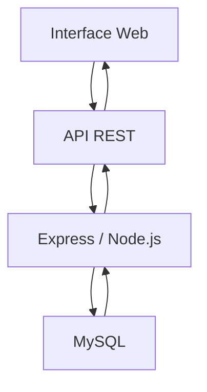
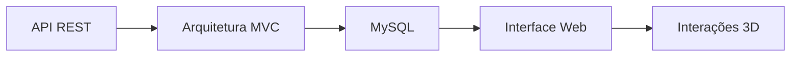

<div align="center">

# 🎬 UniFECAF Flix

### Uma experiência cinematográfica desenvolvida para a web

[🎬 Acessar demonstração online](https://eucarlosz.github.io/unifecaf-flix/)

**Node.js · Express · MySQL · JavaScript · Three.js**

[](https://nodejs.org/)
[](https://expressjs.com/)
[](https://www.mysql.com/)
[](https://developer.mozilla.org/pt-BR/docs/Web/JavaScript)
[](https://threejs.org/)

</div>

---

## Sobre o projeto

O **UniFECAF Flix** nasceu como um projeto acadêmico para desenvolver uma API REST de catálogo de filmes.

Durante o desenvolvimento, decidi ir além da proposta inicial e construir uma interface própria, inspirada na experiência das plataformas de streaming.

O resultado é uma aplicação que combina backend em Node.js, persistência de dados com MySQL e um frontend com animações, efeitos de profundidade e elementos tridimensionais.

## Demonstração online

A interface está disponível gratuitamente pelo GitHub Pages:

**[Acessar UniFECAF Flix](https://eucarlosz.github.io/unifecaf-flix/)**

A demonstração permite explorar os oito filmes, pesquisar títulos e visualizar seus detalhes, mantendo as animações e os efeitos 3D.

Para funcionar no GitHub Pages, essa versão utiliza um catálogo local em JavaScript. A API REST desenvolvida com Node.js, Express e MySQL permanece disponível no código-fonte para execução local.

## Experiência visual

A interface utiliza uma identidade cinematográfica com tons escuros, iluminação azul e transições suaves.

O catálogo apresenta oito filmes, com pôsteres otimizados em WebP e interações que tornam a navegação mais dinâmica.

### Recursos da interface

- Cards de filmes com efeitos 3D
- Animações e transições suaves
- Planeta tridimensional desenvolvido com Three.js
- Efeitos de aproximação e profundidade
- Pesquisa de filmes
- Janela interativa com detalhes dos títulos
- Layout responsivo
- Dados integrados à API REST

## Tecnologias utilizadas

| Camada | Tecnologias |
|---|---|
| Frontend | HTML5, CSS3, JavaScript |
| Experiência 3D | Three.js |
| Backend | Node.js, Express |
| Banco de dados | MySQL |
| Integração | mysql2 |
| Versionamento | Git e GitHub |

## Arquitetura

A aplicação foi organizada para separar a interface, as rotas da API e o acesso ao banco de dados.



O frontend solicita os dados à API, que consulta o banco MySQL e devolve as informações em JSON.

Essa separação facilita a manutenção do projeto e permite evoluir a interface sem concentrar toda a lógica em um único arquivo.

## Estrutura do projeto

```text
unifecaf-flix/
│
├── database/
│   └── database.sql
│
├── public/
│   ├── images/
│   │   ├── a-origem.webp
│   │   ├── aranhaverso.webp
│   │   ├── avengers.webp
│   │   ├── batman.webp
│   │   ├── cidade-de-deus.webp
│   │   ├── coringa.webp
│   │   ├── interestelar.webp
│   │   └── parasita.webp
│   │
│   ├── index.html
│   ├── style.css
│   ├── script.js
│   └── planet.js
│
├── src/
│   ├── config/
│   │   └── database.js
│   └── routes/
│       └── filmeRoutes.js
│
├── .env.example
├── package.json
├── server.js
└── README.md
```

## API REST

A API permite consultar os filmes cadastrados no banco de dados.

| Método | Endpoint | Função |
|---|---|---|
| GET | `/v1/controle-filmes/filme` | Listar filmes |
| GET | `/v1/controle-filmes/filme/:id` | Buscar filme por ID |
| GET | `/v1/controle-filmes/filtro/filme` | Filtrar filmes |

As respostas utilizam o formato JSON.

## Como executar

Para executar o projeto localmente, é necessário ter Node.js e MySQL instalados.

### Clonar o repositório

```bash
git clone https://github.com/eucarlosz/unifecaf-flix.git
cd unifecaf-flix
```

### Instalar as dependências

```bash
npm install
```

### Configurar o MySQL

Execute o script disponível em:

```text
database/database.sql
```

Crie um arquivo `.env` na raiz do projeto com as configurações do seu ambiente:

```env
DB_HOST=localhost
DB_PORT=3306
DB_USER=root
DB_PASSWORD=sua_senha
DB_NAME=unifecaf_flix
```

O `.env.example` serve como referência para essa configuração. As credenciais utilizadas no computador não são incluídas no repositório.

### Iniciar a aplicação

```bash
node server.js
```

Com o servidor iniciado, a interface e a API podem ser acessadas pelo navegador em:

```text
http://localhost:3000
```

A execução descrita acima utiliza o servidor Node.js e o banco MySQL localmente. A demonstração pública do frontend está disponível no GitHub Pages.

## Evolução do projeto

O desenvolvimento foi realizado em etapas, começando pela estrutura da API e avançando até a construção da interface.



Ao longo desse processo, trabalhei com organização de código, integração entre sistemas, consultas ao banco de dados, desenvolvimento de interfaces e versionamento com Git.

## Próximos passos

Entre as melhorias planejadas estão:

- Hospedagem pública da API REST e do banco de dados
- Sistema de autenticação
- Lista de filmes favoritos
- Cadastro e gerenciamento de filmes pela interface
- Testes automatizados da API

## Desenvolvedor

**Carlos Eduardo da Costa Freire**

Estudante de Análise e Desenvolvimento de Sistemas na UniFECAF, com foco em desenvolvimento backend e interesse em Python, Node.js, APIs e bancos de dados.

[](https://github.com/eucarlosz)
[](https://www.linkedin.com/in/carloseduardocostaf/)

---

<div align="center">

**UniFECAF Flix — Projeto acadêmico de Análise e Desenvolvimento de Sistemas**

Desenvolvido em 2026.

</div>
